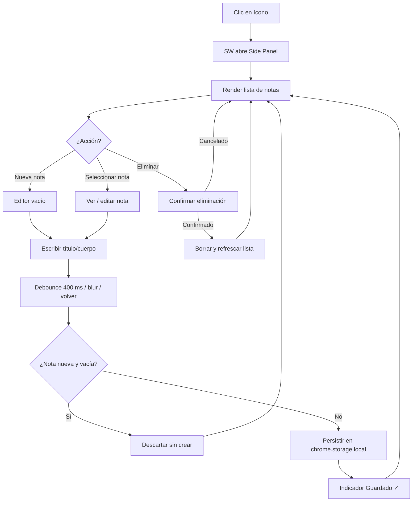
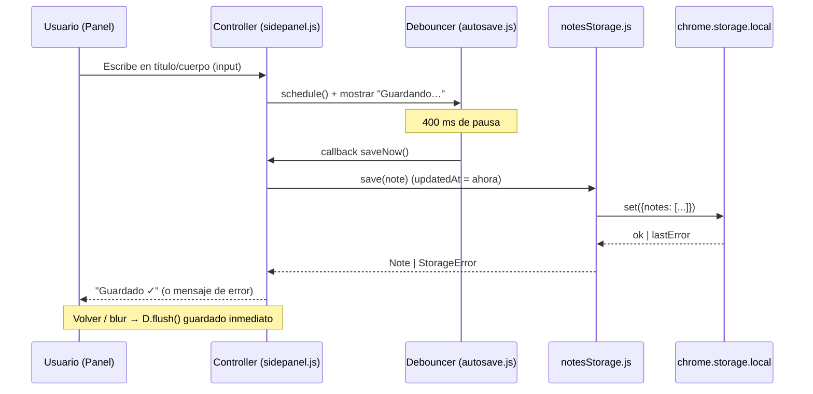

# Diseño — Extensión Chrome de Notas (NoteFur)

## Contexto y supuestos
- Extensión Manifest V3, UI completa en **Side Panel** (se abre con clic en el ícono).
- Persistencia: `chrome.storage.local` (único adaptador), sin nube ni sincronización.
- Stack: **JavaScript vanilla (ES modules) + HTML + CSS**, sin build tooling; tests con **Vitest** (Node).
- Sin framework de UI ni librerías externas: proporcionalidad para una extensión CRUD simple.

## Arquitectura (capas)
```
┌─────────────────────────────┐
│ UI (sidepanel/)             │  renderizado, eventos, mensajes
│  sidepanel.html/js/styles   │
├─────────────────────────────┤
│ Dominio (src/domain/)       │  modelo Note, deriveDisplayTitle, validación
├─────────────────────────────┤
│ Almacenamiento (src/storage/│  notesStorage.js — único módulo que toca
│  notesStorage.js)           │  chrome.storage (recibe storageArea por DI)
├─────────────────────────────┤
│ chrome.storage.local        │  API cruda del navegador
└─────────────────────────────┘
```
- **Composition root**: `sidepanel.js` crea `createNotesStorage(chrome.storage.local)` y lo inyecta al controller de UI. `background.js` (service worker) solo configura el side panel.

## Componentes / módulos
| Archivo | Responsabilidad |
|---------|-----------------|
| `manifest.json` | MV3, side_panel, service_worker, permisos `storage` + `sidePanel` |
| `background.js` | `setPanelBehavior({ openPanelOnActionClick: true })` en `onInstalled` |
| `sidepanel/sidepanel.html` | Vista: lista de notas + editor (título/cuerpo) + botones crear/guardar/eliminar |
| `sidepanel/sidepanel.js` | Controller: render lista, abrir/editar/borrar nota, mensajes de error |
| `sidepanel/styles.css` | Estilos del panel |
| `src/domain/note.js` | Modelo `Note`, `deriveDisplayTitle(note)`, `validateNote(note)` |
| `src/domain/autosave.js` | `createDebouncer(fn, delayMs)`: `schedule()` / `flush()` / `cancel()` — lógica pura del guardado automático |
| `src/storage/notesStorage.js` | Adaptador CRUD sobre `storageArea` inyectado (API `{get,set}` promisificada) |
| `tests/` | Vitest: `note.test.js`, `notesStorage.test.js`, `autosave.test.js` |

## Modelo de datos
```js
Note = {
  id:        string,   // uuid v4 (crypto.randomUUID)
  title:     string,   // puede ser ""
  body:      string,   // puede ser ""
  createdAt: number,   // epoch ms — inmutable tras creación
  updatedAt: number    // epoch ms — se actualiza en cada save/update
}
```
- Storage: una sola clave `notes` → `Note[]`. Orden de lista: `updatedAt` descendente (más reciente primero).

## Errores
- **Nota nueva vacía** (sin título ni cuerpo): ya no se bloquea un "guardado" (no existe botón). La UI **descarta** la nota nueva sin contenido al volver a la lista (Req 1.3). `validateNote`/`ValidationError` permanecen en el dominio como contrato testable.
- **Fallo de `chrome.storage`** (`lastError`): `StorageError` → la UI muestra mensaje de error y loguea en consola (sin `catch` vacío).
- **Eliminación**: confirmación nativa `confirm()` antes de borrar (Req 3.1); simplificación asumida (un modal propio sería sobre-ingeniería en v1).

## Autosave (guardado automático)
- **Debounce**: `createDebouncer` con 400 ms. Cada `input` en título/cuerpo llama `schedule()` (reinicia el temporizador). El guardado solo ocurre tras 400 ms de pausa.
- **Flush**: al `blur` del editor y al pulsar "Volver" se llama `flush()` → guardado inmediato de lo pendiente (Req 2.5).
- **Descarte**: si la nota es nueva (`editingId === null`) y título+cuerpo están vacíos, `flush`/volver no crea nada (Req 1.3).
- **Indicador** (Req 2.6): `schedule()` → muestra "Guardando…"; al completar el save → "Guardado ✓" (se oculta a los 2 s).
- **Rendimiento (RNF-5)**: `chrome.storage.local.set` es asíncrono; el debounce evita escrituras por tecla; la lista no se re-renderiza durante la edición (está oculta).

## Estrategia de pruebas (Vitest)
- `deriveDisplayTitle`: tabla de casos — título presente; título vacío con cuerpo ≥3 palabras; <3 palabras; cuerpo vacío (Req 4.1–4.3).
- `validateNote`: nota vacía → rechaza; con título o cuerpo → acepta (Req 1.3).
- `createDebouncer` con **fake timers** (`vi.useFakeTimers`): no ejecuta antes del delay; ejecuta tras 400 ms; `schedule` repetido reinicia; `flush` ejecuta inmediatamente una sola vez; `cancel` evita la ejecución (Req 2.4, 2.5).
- `notesStorage` con **fake de storageArea** (get/set en memoria): crear persiste; listar ordena por `updatedAt`; update no duplica; delete elimina; fallo de storage → `StorageError` (camino de error con fake, quality-bar #8).
- `background.js` no tiene lógica testeable (configuración pura).

## Invariantes críticos
1. Los `id` de notas son únicos dentro de `notes`.
2. La lista siempre se muestra ordenada por `updatedAt` descendente.
3. `deriveDisplayTitle` nunca devuelve cadena vacía para una nota existente.
4. `updatedAt` siempre se refresca al crear/guardar; `createdAt` nunca cambia en updates.
5. La UI nunca llama a `chrome.storage` directamente (solo vía adaptador).

## Excepciones al quality-bar
- **Tipos (#11)**: JS vanilla sin TypeScript — decisión de proporcionalidad (extensión sin toolchain). Los contratos se documentan con JSDoc en `note.js` y `notesStorage.js`.

## Diagramas

### Flowchart — flujo del panel


### Sequence — autosave (editar nota existente)

