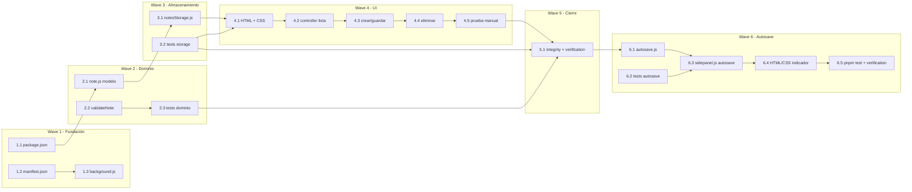

# Tareas — Extensión Chrome de Notas (NoteFur)

- [x] 1.1 Inicializar `package.json` con Vitest como devDependency (Req testing, quality-bar #8) — `package.json` + `node_modules/` con vitest 4.1.11
- [x] 1.2 Crear `manifest.json` (MV3: side_panel, service_worker, permisos `storage` + `sidePanel`) (RNF-1, RNF-4) — `manifest.json`
- [x] 1.3 Crear `background.js` con `setPanelBehavior({ openPanelOnActionClick: true })` en `onInstalled` (RNF-4) — `background.js`
- [x] 2.1 Crear `src/domain/note.js`: modelo `Note` + `deriveDisplayTitle` (Req 4.1, 4.2, 4.3) — `src/domain/note.js`
- [x] 2.2 Crear `validateNote` en `src/domain/note.js` → `ValidationError` (Req 1.3) — `src/domain/note.js`
- [x] 2.3 [P] Crear `tests/note.test.js`: tabla de casos `deriveDisplayTitle` + validación (Req 4.1–4.3, 1.3) — `tests/note.test.js` (9 tests)
- [x] 3.1 Crear `src/storage/notesStorage.js`: adaptador CRUD con DI (`storageArea`), orden por `updatedAt` desc, `StorageError` (Req 1.2, 2.1, 2.4, 3.2; RNF-2; invariantes 1, 2, 4) — `src/storage/notesStorage.js`
- [x] 3.2 [P] Crear `tests/notesStorage.test.js` con fake de storage: crear/listar/update-sin-duplicar/delete + camino de error (Req 1.2, 2.4, 3.2) — `tests/notesStorage.test.js` (7 tests)
- [x] 4.1 Crear `sidepanel/sidepanel.html` + `styles.css`: layout lista + editor (título/cuerpo) + botones (Req 1.1, 2.1) — `sidepanel/sidepanel.html`, `sidepanel/styles.css`
- [x] 4.2 Implementar `sidepanel/sidepanel.js`: composition root (inyectar storage), render lista con `deriveDisplayTitle`, seleccionar para lectura (Req 2.1, 2.2; invariante 3) — `sidepanel/sidepanel.js`
- [x] 4.3 Implementar en `sidepanel.js`: nueva nota, guardar con validación y mensaje de error, refresh de lista (Req 1.1, 1.2, 1.3, 2.3, 2.4) — `sidepanel/sidepanel.js`
- [x] 4.4 Implementar en `sidepanel.js`: eliminar con `confirm()` + refresh (Req 3.1, 3.2) — `sidepanel/sidepanel.js`
- [ ] 4.5 Probar carga manual en Chrome (chrome://extensions, modo desarrollador) y flujo completo (RNF-1, RNF-3, RNF-4) — **pendiente de validación del usuario**
- [x] 6.1 Crear `src/domain/autosave.js`: `createDebouncer(fn, delayMs)` con `schedule`/`flush`/`cancel` (Req 2.4, 2.5) — `src/domain/autosave.js`
- [x] 6.2 [P] Crear `tests/autosave.test.js` con fake timers (Req 2.4, 2.5) — `tests/autosave.test.js` (6 tests)
- [x] 6.3 Actualizar `sidepanel.js`: conectar debounce a `input`/`blur`/volver, descarte de nota nueva vacía, indicador de estado (Req 1.2, 1.3, 2.4, 2.5, 2.6) — `sidepanel/sidepanel.js`
- [x] 6.4 Actualizar `sidepanel.html` + `styles.css`: quitar botón Guardar, añadir indicador de estado (Req 2.6) — `sidepanel/sidepanel.html`, `sidepanel/styles.css`
- [x] 6.5 Ejecutar `pnpm test` (suite completa en verde, 22/22) y actualizar `verification.md` con Wave 6 (Req 2.4–2.6) — `verification.md`
- [omitido: PBT no aplica — los invariantes son narrativos; cobertura con tabla de casos en Vitest]
- [x] 5.1 Integrity gate: `[x]` con artefactos reales, `pnpm test` verde (16/16), verificación documentada en `verification.md` (Fase 4) — `verification.md`

## Grafo de waves

## Secuencia de implementación
Wave 1 → Wave 2 (paralelo 2.3 con 2.2) → Wave 3 (3.2 en paralelo) → Wave 4 (secuencial, 4.1 → 4.4) → Wave 5 → Wave 6 (6.1/6.2 en paralelo → 6.3 → 6.4 → 6.5).
