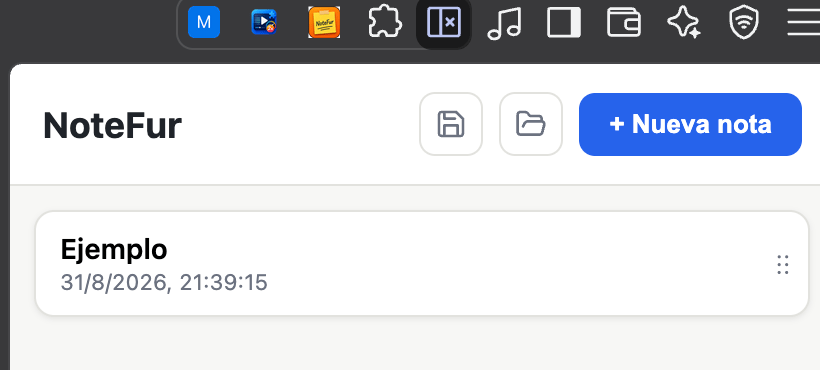

# NoteFur 🗒️

Extensión de Chrome para gestionar notas desde el **panel lateral** (Side Panel API). Escribe, edita y elimina notas con guardado automático, todo en Manifest V3.



## Características

- **Panel lateral**: toda la UI vive en el Side Panel de Chrome, se abre con un clic en el ícono.
- **CRUD completo**: crear, leer, editar y eliminar notas.
- **Guardado automático (autosave)**: se persiste solo 400 ms después de dejar de escribir, al perder el foco o al volver a la lista. Indicador "Guardando… / Guardado ✓".
- **Título derivado**: si una nota no tiene título, la lista muestra las 3 primeras palabras del cuerpo (o el cuerpo completo si tiene menos de 3 palabras; "(Sin título)" si está vacía).
- **Persistencia local**: las notas se guardan en `chrome.storage.local` y sobreviven al reinicio del navegador.
- **Sin dependencias de runtime**: JavaScript vanilla, sin frameworks ni toolchain de build.

## Instalación (modo desarrollador)

1. Clona o descarga el proyecto:
   ```bash
   git clone https://github.com/furthurr/NoteFur.git
   ```
2. Abre Chrome y navega a `chrome://extensions`.
3. Activa el **Modo desarrollador** (esquina superior derecha).
4. Pulsa **Cargar descomprimida** y selecciona la carpeta del proyecto.
5. Fija la extensión junto a la barra de direcciones y haz clic en el ícono para abrir el panel lateral.

## Uso

- **Crear**: pulsa "+ Nueva nota" y escribe. Se guarda solo.
- **Leer/editar**: haz clic en cualquier nota de la lista. Los cambios se guardan automáticamente.
- **Eliminar**: dentro de una nota, pulsa "Eliminar" y confirma.

## Desarrollo

```bash
pnpm install        # instalar dependencias de desarrollo (Vitest)
pnpm test           # ejecutar la suite de tests (22 tests)
```

> El proyecto usa `pnpm`. Si usas npm, ten en cuenta que este equipo tiene configurado el alias `npm → pnpm` en el perfil de PowerShell.

## Estructura

```
NoteFur/
├── manifest.json              → Config MV3 (Side Panel, permisos, íconos)
├── background.js              → Service Worker (abre el panel con el clic)
├── sidepanel/                 → UI completa del panel (HTML/CSS/JS)
├── src/
│   ├── domain/                → Modelo Note, título derivado, validación, debounce
│   └── storage/               → Adaptador de chrome.storage (única capa de persistencia)
├── tests/                     → Suite Vitest (dominio, storage, autosave)
├── icons/                     → Íconos 16/32/48/128 px
└── .sdd/specs/                → Spec SDD: requisitos, diseño, tareas, verificación
```

## Arquitectura

Capas separadas con inyección de dependencias: la UI nunca toca `chrome.storage` directamente — todo pasa por el adaptador `src/storage/notesStorage.js`, lo que permite testear con fakes.

## Autor

Pedro G. V. [@furthurr](https://github.com/furthurr)

- GitHub: https://github.com/furthurr
- Email: pedrogvas@gmail.com

## Licencia

Apache-2.0
